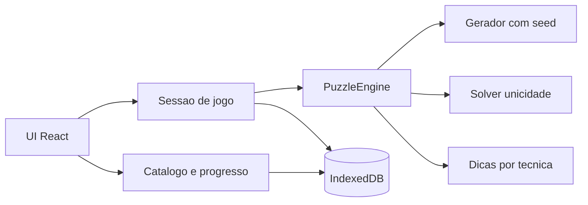

# Arquitetura

Decisões que o código segue. Quando uma delas mudar, este documento muda junto.

## Princípios

- **Local-first:** Vite serve o app; o browser guarda o estado
- **Motores puros:** geração, validação, unicidade e dicas não importam React
- **Um contrato por jogo:** a UI de sessão fala com `PuzzleEngine`, não com detalhes de Queens vs. Zip
- **Seed + versão:** replay é reprodução, não “outro tabuleiro parecido”
- **Geração fora da thread da UI:** Web Worker



## Pastas

```
src/
  app/                 # shell: rotas, layout, histórico, settings
  play/                # sessão: cronômetro, dicas, desfazer, conclusão
  engines/
    core/              # PuzzleEngine, Difficulty, HintLevel, RNG de seed
    queens/
    tango/
    zip/
    mini-sudoku/
    patches/
  persist/             # Dexie, export/import JSON
  workers/             # generatePuzzle(game, seed, difficulty)
  ui/
    boards/            # grades específicas (clique, path, retângulo)
```

Testes em `src/**/*.test.ts` (Vitest, config em `vitest.config.ts`).

## Convenção de nomes

- **Código em inglês:** identificadores, tipos, nomes de arquivo e componentes (`HistoryLayout`, `PuzzleAttemptsPage`, `finishAttempt`).
- **Interface e documentação em português:** textos visíveis, mensagens de erro, `aria-label` e arquivos em `docs/`.
- **Rotas em português** quando aparecem para quem joga (`/mesa`, `/game/:id/tempos`, `/fase/:id`, `/nova`); `game`, `play` e `settings` ficam em inglês por compatibilidade com links já salvos.
- Testes descrevem o comportamento no idioma do módulo: motores em inglês, persistência e UI em português.

## Contrato `PuzzleEngine`

Cada jogo exporta um objeto que implementa o mesmo tipo (nomes aproximados):

```ts
generate(seed: string, difficulty: Difficulty, generatorVersion: string): Puzzle
validate(puzzle: Puzzle, state: State): RuleViolation[]
isSolved(puzzle: Puzzle, state: State): boolean
applyMove(state: State, move: Move): State
hint(puzzle: Puzzle, state: State, level: HintLevel): Hint
serialize(puzzle: Puzzle): string
deserialize(payload: string): Puzzle
```

- `generate` é **determinístico** para o mesmo `(seed, difficulty, generatorVersion)`
- Se o algoritmo de geração mudar de forma incompatível, sobe `generatorVersion` e fases antigas continuam a reproduzir com a versão gravada
- `hint` pode devolver `null` se não houver dedução naquele nível (aí a UI sobe o nível ou avisa)

Dificuldade da v1: `easy | medium | hard`. Cada motor mapeia isso para tamanho, densidade de pistas e teto de técnicas.

## Dicas

| Nível | O que a UI mostra | O que o motor devolve |
| --- | --- | --- |
| 1 | Destaque | Células/regiões alvo |
| 2 | Nome da técnica | `techniqueId` + rótulo em PT |
| 3 | Texto | Explicação da dedução |
| 4 | Aplica lance | `Move` aplicável |
| 5 | Walkthrough | Lista ordenada de `Hint` nível 3+4 |

Nível 5 pode ser salvo como `Solution` da fase.

Zip e Patches, na v1, podem implementar só 1, 4 e 5; Queens, Tango e Mini Sudoku implementam 1–5. Ver critérios em [SCOPE.md](SCOPE.md).

## Modelo de dados (IndexedDB via Dexie)

**puzzles**

- `id` (uuid)
- `game` (`queens` \| `tango` \| `zip` \| `mini-sudoku` \| `patches`)
- `seed`
- `difficulty`
- `generatorVersion`
- `payload` (JSON do tabuleiro)
- `createdAt`

**attempts**

- `id`
- `puzzleId`
- `startedAt` / `finishedAt`
- `elapsedMs`
- `hintsUsed` (contagem por nível)
- `completed` (boolean)
- `finalState` (opcional, snapshot)

**solutions**

- `id`
- `puzzleId`
- `createdAt`
- `source` (`player` \| `walkthrough`)
- `steps` (lista de lances / hints)

Índices: `game`, `puzzleId`, `completed`. Export JSON = dump dessas três tabelas + `meta.schemaVersion`.

## Persistência e backup

- Fonte da verdade: IndexedDB
- Botão **Exportar** baixa `linkedin-games-save.json`
- Botão **Importar** faz merge por `id` (não apaga o que já existe, a menos que o usuário peça substituir)
- Antes de gravar, `validateSaveFile` (`src/persist/saveFile.ts`) confere versão do schema e cada linha; um arquivo inválido não grava nada e a UI lista os problemas
- A importação roda numa única transação: se algo falhar no meio, nada muda
- Na abertura, `checkStorage` tenta abrir o IndexedDB; se o navegador bloquear (modo privado, armazenamento desligado), o app avisa que nada será salvo
- Replay: carregar `payload` salvo **ou** chamar `generate` com o mesmo seed/versão; os testes exigem que os dois coincidam

## UI (shell)

Rotas (com `HashRouter`, todas depois do `#`):

- `/` — Marcas: cada jogo com fases, resoluções e melhor tempo
- `/mesa` — escolher jogo, dificuldade e seed para gerar uma fase
- `/game/:gameId` — caderno do jogo: lista, `tempos` (gráfico), `fase/:puzzleId` (execuções), `nova`
- `/play/:puzzleId` — sessão
- `/settings` — tema, auto-check, auto-X (Queens), teto de dica, import/export, apagar save

`/stats` e `/history` redirecionam para `/`. Sem autenticação.

### Tema e acessibilidade

- Cores só por variáveis CSS em `:root` (`src/styles.css`). O tema escuro redefine as mesmas variáveis em `prefers-color-scheme: dark` e em `[data-theme="dark"]`; Ajustes grava `auto | light | dark`, e o `index.html` aplica antes da primeira pintura.
- Texto sobre casas pastel usa `--cell-ink`, fixo nos dois temas.
- Conflitos usam cor + hachura + contorno, e as casas expõem `aria-invalid`.
- Tabuleiros de clique (Queens, Tango, Mini Sudoku) usam roving tabindex (`src/ui/boards/useRovingGrid.ts`): Tab entra no tabuleiro, setas movem, Home/End vão às pontas. Casas dadas usam `aria-disabled` em vez de `disabled`, para continuarem focáveis.

## Publicação

- `vite.config.ts` usa `base: "./"`: scripts, CSS e o worker saem com caminho relativo.
- `HashRouter` dispensa reescrita de rotas no GitHub Pages.
- `.github/workflows/deploy.yml`: testes, build, `scripts/check-dist.mjs` e deploy de `dist/` a cada push na `main`.
- `.github/workflows/ci.yml`: as mesmas checagens em PRs e outros branches.

## Geração no Worker

A UI manda `{ game, seed, difficulty, generatorVersion }` e espera `{ puzzle }` ou `{ error }`. `generatePuzzle` devolve `{ promise, cancel }`: cancelar encerra o worker na hora e a promise rejeita com `GenerationCancelled`. A Mesa mostra o tempo decorrido e o botão Cancelar; sair da página também cancela.

## Testes mínimos por motor

- Regras: estado inválido é detectado; estado solução passa em `isSolved`
- Unicidade: `generate` produz puzzle com uma só solução
- Seed: dois `generate` iguais batem byte a byte no `serialize`
- Hint nível 4, num estado intermediário conhecido, aplica um lance legal que reduz o espaço
