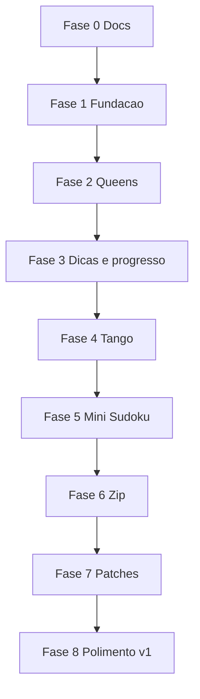

# Roadmap

Fases sequenciais. Cada fase assume a anterior está utilizável.

**Estado atual (out/2026):** os cinco jogos da v1 geram e jogam ponta a ponta. O que falta para fechar a v1 é o sistema de dicas (Fase 3, que bloqueia os itens de dica das Fases 4–7) e o polimento da Fase 8. As trilhas paralelas A e B (publicação e visual) estão quase todas entregues; o que sobrou está marcado abaixo.

## Fase 0 — Documentação

**Status: concluída.**

- README, escopo, regras, arquitetura, este roadmap
- Sem código de aplicação

**Pronto quando:** os cinco arquivos de docs existem e descrevem v1, fora de escopo e stack.

## Fase 1 — Fundação

**Status: concluída.**

- Scaffold Vite + React + TypeScript + Vitest
- Dexie com as tabelas `puzzles`, `attempts`, `solutions`
- Shell: home, histórico vazio, settings (export/import stub)
- Tipo `PuzzleEngine` e um motor `noop` só para ligar a sessão
- Worker stub de geração

**Pronto quando:** `npm run dev` abre o shell e os testes do contrato compilam.

## Fase 2 — Queens ponta a ponta

**Status: concluída.**

Primeiro jogo real: prova o contrato com UI de clique.

- Gerador n×n com regiões, seed e unicidade
- Jogar: vazio / X / coroa, desfazer, limpar
- Validar conflitos (linha, coluna, região, toque)
- Detectar conclusão e gravar tentativa

**Pronto quando:** dá para gerar fácil/médio/hard, resolver, e reabrir o mesmo seed.

## Fase 3 — Dicas + progresso

**Status: parcial.** Progresso entregue; dicas não começaram (os motores devolvem `null` e o botão Dica fica desabilitado).

Ainda em Queens, para não espalhar o sistema de save.

- [ ] Cinco níveis de dica
- [x] Cronômetro na tentativa
- [ ] `hintsUsed` preenchido na tentativa
- [x] Tela de histórico: rejogar, ver melhor tempo
- [ ] Salvar walkthrough (nível 5) em `solutions`
- [x] Export/import JSON de verdade (com validação; ver trilha A)

**Pronto quando:** uma fase de Queens sobrevive a reload, export e reimport, e as dicas alteram o registro da tentativa.

## Fase 4 — Tango

**Status: jogável; dicas pendentes (dependem da Fase 3).**

- [x] Motor 6×6 com `=` / `×`, equilíbrio 3/3, sem trios
- [x] UI de símbolos
- [ ] Dicas níveis 1–5
- [x] Mesmo fluxo de histórico/replay

**Pronto quando:** Tango está no home ao lado de Queens, com seed reproduzível.

## Fase 5 — Mini Sudoku

**Status: jogável; dicas e dificuldade por técnica pendentes.**

- [x] Motor 6×6, caixas 2×3
- [ ] Dificuldade por técnicas, não só por buracos (a confirmar no gerador)
- [ ] Dicas ricas (único candidato, único na unidade, …)
- [x] Teclado para dígitos (e setas para navegar nas casas)

**Pronto quando:** os três jogos de clique compartilham sessão, dicas e save sem forks.

## Fase 6 — Zip

**Status: jogável; dicas pendentes.**

- [x] Caminho hamiltoniano + números + paredes
- [x] UI de arraste e recuo
- [ ] Dicas: pelo menos níveis 1, 4 e 5
- [x] Unicidade do caminho

**Pronto quando:** Zip gera e joga no mesmo shell; seed reproduz paredes e números.

## Fase 7 — Patches

**Status: jogável; dicas pendentes.**

- [x] Partição Shikaku com restrição de forma
- [x] UI de desenhar retângulo por pista
- [x] Pistas numeradas na v1; freeform só se unicidade for barata
- [ ] Dicas: pelo menos níveis 1, 4 e 5

**Pronto quando:** os cinco jogos da v1 existem ponta a ponta.

## Fase 8 — Polimento v1

**Status: em curso.**

- [ ] Dificuldades estáveis (calibrar easy/medium/hard com uma bateria de seeds)
- [x] Estatísticas por jogo (em Marcas `/`, com melhor tempo)
- [x] Acessibilidade: teclado nos jogos de clique, contraste, Queens não só por cor
- [x] Cancelar geração lenta; mensagens de erro claras
- [x] README de uso (instalar, jogar, exportar save)
- [ ] Notas/candidatos no Mini Sudoku

**Pronto quando:** os critérios de [SCOPE.md](SCOPE.md) estão todos marcados.

## Trilha paralela A — Publicação e qualidade

Origem: [MELHORIAS.md](MELHORIAS.md), seções 1, 2 e 3. **Status: entregue no código; falta ativar o Pages e confirmar o primeiro deploy.**

**Publicação (GitHub Pages)**

- [x] Definir `base` no `vite.config.ts` (escolhido `./`)
- [x] Roteamento compatível com Pages (escolhido `HashRouter`)
- [x] Criar `.github/workflows/deploy.yml` (`npm ci`, testes, build, smoke, `actions/deploy-pages`)
- [ ] Ativar Pages em Settings → Pages → Source: GitHub Actions *(manual, no GitHub)*
- [ ] Validar o site publicado: abrir cada rota direto pela URL e gerar uma fase de cada jogo
- [x] Verificar que o Web Worker sai no build com `base` relativo (checado por `scripts/check-dist.mjs`)
- [x] Adicionar `homepage` e `repository` no `package.json`
- [x] Adicionar `<meta name="description">` e Open Graph no `index.html`

**Consistência da documentação**

- [x] Atualizar o README: estado real, comandos, publicação, onde ficam os dados
- [x] Sincronizar o status de cada fase acima com as entregas reais
- [x] `npm test` agora roda uma vez (`vitest run`); `npm run test:watch` fica com o modo watch
- [x] Adicionar `LICENSE` (MIT)
- [x] Registrar em `ARCHITECTURE.md` a convenção de nomes

**Qualidade e CI**

- [x] Rodar `npm test` e `tsc -b` limpos no CI
- [x] Separar a config de teste (`vitest.config.ts`); `vite.config.ts` não importa mais o Vitest
- [x] Workflow de CI com testes e build em PRs e branches
- [x] Teste de smoke do build (`npm run check:dist`: caminhos relativos, assets existentes, worker emitido)
- [x] Validar schema e versão no import JSON antes de gravar, com erro legível e importação atômica
- [x] Mensagem clara quando o IndexedDB estiver indisponível
- [x] Botão para cancelar geração lenta
- [ ] Smoke em navegador real (Playwright) abrindo o `dist/` e gerando uma fase

## Trilha paralela B — Visual e experiência

Origem: [MELHORIAS.md](MELHORIAS.md), seção 4. **Status: maior parte entregue; itens abertos abaixo.**

**Tema e contraste**

- [x] Modo escuro: tokens em `prefers-color-scheme: dark` e seletor em Ajustes (sistema, claro, escuro)
- [x] Contraste WCAG AA medido e ajustado (texto secundário, links e botão principal em cobre); valores em [MELHORIAS.md](MELHORIAS.md)
- [x] Conflitos com hachura e contorno além da cor, e `aria-invalid` nas casas

**Layout e responsividade**

- [x] Barra superior compacta e fixa abaixo de 800px; layout próprio abaixo de 480px
- [x] Tabuleiros com largura total no celular; botões de ação com 44px de altura
- [ ] Queens difícil (9×9) fica com casas de ~37px numa tela de 360px; avaliar zoom ou margem menor
- [x] Largura máxima do conteúdo na folha principal (já existia: 44rem)

**Hierarquia e clareza**

- [ ] Faixa fixa com progresso (ex.: casas preenchidas) além de tempo e dicas
- [ ] Resumo na vitória com dificuldade e dicas usadas (depende das dicas)
- [x] Marcas mostram fases, resoluções e melhor tempo por jogo
- [x] Estados vazios com próximo passo (estilo `.empty` adicionado; textos já existiam)

**Movimento e polimento**

- [x] Transições discretas nas casas e no aviso de vitória, desligadas com `prefers-reduced-motion`
- [x] Anel de foco visível em todas as casas e nos controles; link "Pular para o conteúdo"
- [x] Navegação por setas em Queens, Tango e Mini Sudoku
- [ ] Jogar Zip e Patches só com teclado (hoje dependem de arrastar)
- [ ] Conjunto único de ícones de ação, com rótulo acessível

**Identidade**

- [x] Favicon, ícones PNG (192, 512, maskable, Apple) e `manifest.webmanifest`
- [x] Tela de geração com barra, tempo decorrido, aviso após 4s e Cancelar
- [ ] Mostrar a etapa real da geração (exige o worker reportar progresso)

---

## Ordem das trilhas paralelas

Com as trilhas A e B quase fechadas, o próximo bloco é a Fase 3 (dicas), que destrava os itens de dica das Fases 4–7 e o resumo de vitória da trilha B. Novos componentes de tabuleiro devem usar os tokens de cor e o `useRovingGrid` desde o início.

---

## Depois da v1 (não implementar agora)

- **Pinpoint, Crossclimb, Wend** — exigem banco de pistas/palavras, não só constraint solver
- Editor manual de tabuleiros
- App desktop (Electron) ou PWA com uso offline (o manifesto já permite instalar; falta service worker)
- Sincronização do JSON via pasta/arquivo vigiado
- Mais tamanhos e modos (ex.: Mini Sudoku com regiões irregulares, Tango maior)

## Ordem e por quê

Queens, Tango e Mini Sudoku vêm antes porque a UI é clique e dá para fechar persistência e dicas cedo. Zip e Patches dependem de arraste/desenho — mais risco de retrabalho se o contrato da sessão ainda estiver mudando.
