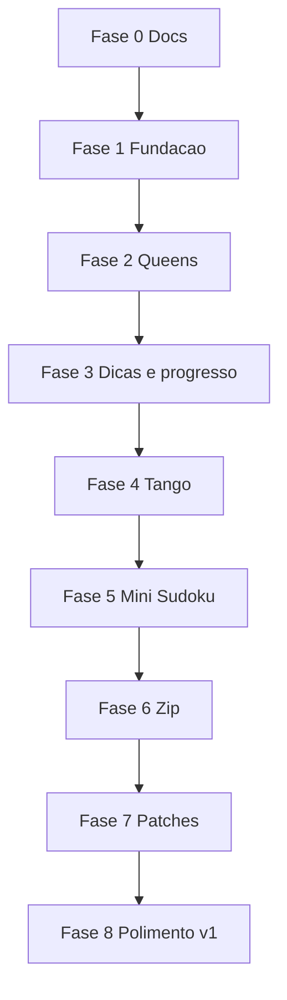

# Roadmap

Fases sequenciais. Cada fase assume a anterior está utilizável. A Fase 0 é documentação (estado atual).

## Fase 0 — Documentação

**Status: concluída.**

- README, escopo, regras, arquitetura, este roadmap
- Sem código de aplicação

**Pronto quando:** os cinco arquivos de docs existem e descrevem v1, fora de escopo e stack.

## Fase 1 — Fundação

- Scaffold Vite + React + TypeScript + Vitest
- Dexie com as tabelas `puzzles`, `attempts`, `solutions`
- Shell: home, histórico vazio, settings (export/import stub)
- Tipo `PuzzleEngine` e um motor `noop` só para ligar a sessão
- Worker stub de geração

**Pronto quando:** `npm run dev` abre o shell e os testes do contrato compilam.

## Fase 2 — Queens ponta a ponta

Primeiro jogo real: prova o contrato com UI de clique.

- Gerador n×n com regiões, seed e unicidade
- Jogar: vazio / X / coroa, desfazer, limpar
- Validar conflitos (linha, coluna, região, toque)
- Detectar conclusão e gravar tentativa

**Pronto quando:** dá para gerar fácil/médio/hard, resolver, e reabrir o mesmo seed.

## Fase 3 — Dicas + progresso

Ainda em Queens, para não espalhar o sistema de save.

- Cinco níveis de dica
- Cronômetro e `hintsUsed` na tentativa
- Tela de histórico: rejogar, ver melhor tempo
- Salvar walkthrough (nível 5) em `solutions`
- Export/import JSON de verdade

**Pronto quando:** uma fase de Queens sobrevive a reload, export e reimport, e as dicas alteram o registro da tentativa.

## Fase 4 — Tango

- Motor 6×6 com `=` / `×`, equilíbrio 3/3, sem trios
- UI de símbolos
- Dicas níveis 1–5
- Mesmo fluxo de histórico/replay

**Pronto quando:** Tango está no home ao lado de Queens, com seed reproduzível.

## Fase 5 — Mini Sudoku

- Motor 6×6, caixas 2×3
- Dificuldade por técnicas, não só por buracos
- Dicas ricas (único candidato, único na unidade, …)
- Teclado para dígitos

**Pronto quando:** os três jogos de clique compartilham sessão, dicas e save sem forks.

## Fase 6 — Zip

- Caminho hamiltoniano + números + paredes
- UI de arraste e recuo
- Dicas: pelo menos níveis 1, 4 e 5
- Unicidade do caminho

**Pronto quando:** Zip gera e joga no mesmo shell; seed reproduz paredes e números.

## Fase 7 — Patches

- Partição Shikaku com restrição de forma
- UI de desenhar retângulo por pista
- Pistas numeradas na v1; freeform só se unicidade for barata
- Dicas: pelo menos níveis 1, 4 e 5

**Pronto quando:** os cinco jogos da v1 existem ponta a ponta.

## Fase 8 — Polimento v1

- Dificuldades estáveis (calibrar easy/medium/hard com uma bateria de seeds)
- Estatísticas por jogo (`/stats`)
- Acessibilidade: teclado nos jogos de clique, contraste, Queens não só por cor
- Cancelar geração lenta; mensagens de erro claras
- README de uso (instalar, jogar, exportar save)
- Notas/candidatos no Mini Sudoku se ainda não tiverem entrado

**Pronto quando:** os critérios de [SCOPE.md](SCOPE.md) estão todos marcados.

---

## Depois da v1 (não implementar agora)

- **Pinpoint, Crossclimb, Wend** — exigem banco de pistas/palavras, não só constraint solver
- Editor manual de tabuleiros
- App desktop (Electron) ou PWA instalável
- Sincronização do JSON via pasta/arquivo vigiado
- Mais tamanhos e modos (ex.: Mini Sudoku com regiões irregulares, Tango maior)

## Ordem e por quê

Queens, Tango e Mini Sudoku vêm antes porque a UI é clique e dá para fechar persistência e dicas cedo. Zip e Patches dependem de arraste/desenho — mais risco de retrabalho se o contrato da sessão ainda estiver mudando.
